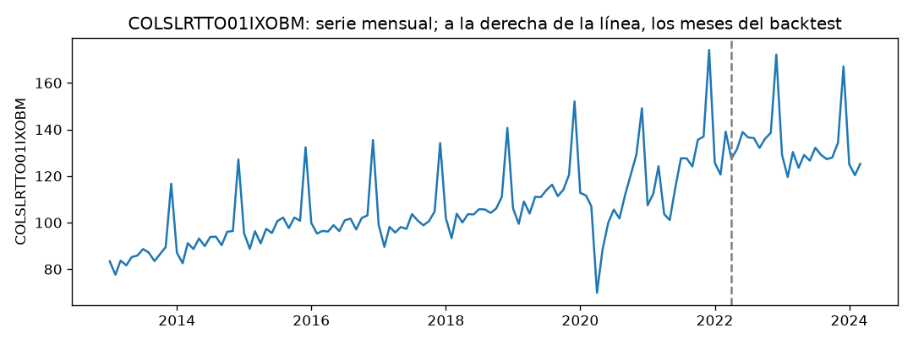
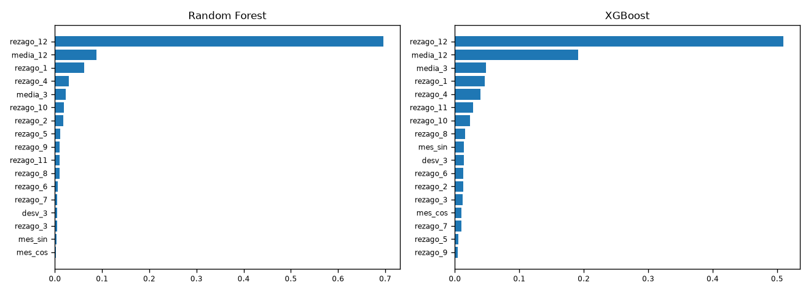
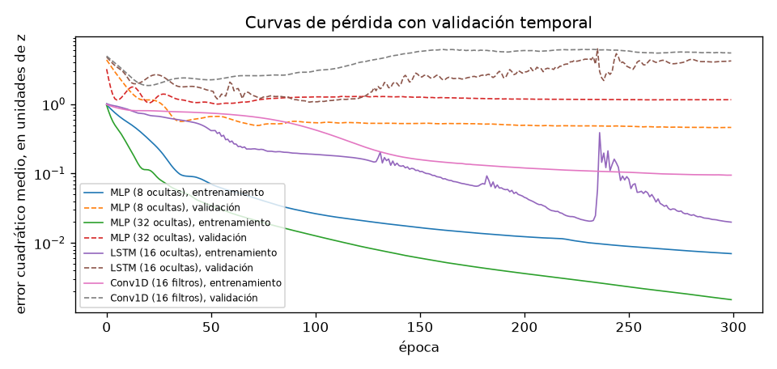
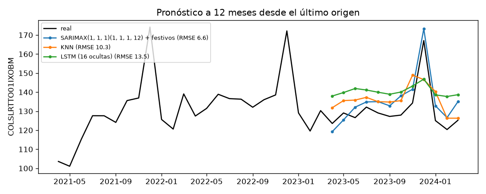

# Informe del miniproyecto 2

Llene cada sección reemplazando los marcadores `{{...}}`, sin quitar las
secciones. Las cifras salen de lo que imprime `python miniproyecto.py` y las
figuras son las que ese guion deja en `figuras/`. Las fórmulas van en LaTeX
(`$...$` o `$$...$$`).

## 1. La serie y el modelo a superar

La serie es el **índice de volumen del comercio minorista de Colombia** (base
2015=100, sin desestacionalizar; OCDE vía FRED), mensual de 2013-01 a 2024-03:
**135 observaciones**. La decisión se trae igual del miniproyecto 1: la serie
no tiene huecos (la interpolación lineal queda solo como respaldo) y los
máximos de diciembre, por encima de 160 en 2021-2023, se conservan porque son
el pico estacional real y no errores.



El mejor modelo ajustado del miniproyecto 1 (el estacional ingenuo, una línea
base, quedó por delante) es el
**$\text{SARIMAX}(1,1,1)(1,1,1)_{12}$ con los festivos del mes como exógena**.
Con $x_t$ el número de festivos de Colombia en el mes $t$:

$$y_t = \beta\, x_t + \eta_t, \qquad
(1 - \phi_1 B)(1 - \Phi_1 B^{12})(1 - B)(1 - B^{12})\, \eta_t =
(1 + \theta_1 B)(1 + \Theta_1 B^{12})\, \varepsilon_t.$$

Los festivos se precalcularon en `datos/festivos_colombia.csv` con el mismo
cálculo del miniproyecto 1, para que el guion no dependa del paquete
`holidays`. En este *backtest* el modelo da **RMSE 9.47, MAE 8.58 y MAPE
6.56 %**, las mismas cifras del miniproyecto 1, porque se usan la misma serie,
la misma preparación, los mismos órdenes y el mismo `comun.py`.

El modelo a superar en la práctica es el **estacional ingenuo** (RMSE 7.33,
MAE 5.80, MAPE 4.41 %), que ya le ganaba al SARIMAX en el miniproyecto 1: la
estacionalidad de esta serie es tan fuerte y tan estable que repetir el mismo
mes del año anterior captura casi todo.

**Atípicos, buscados en el residuo de la STL.** En el miniproyecto 1 los
atípicos se buscaron con un $z$ global sobre la serie. Aquí se buscan donde
corresponde: en el residuo $r_t$ de la STL robusta de periodo 12, con un $z$
robusto que no se deja arrastrar por los propios atípicos,

$$z_t = 0.6745\,\frac{r_t - \operatorname{mediana}(r)}{\operatorname{MAD}(r)},
\qquad \operatorname{MAD}(r) = \operatorname{mediana}\lvert r_t - \operatorname{mediana}(r)\rvert .$$

El MAD es apenas $0.61$, así que el umbral $\lvert z_t\rvert > 3.5$ es exigente
y marca 21 meses. El atípico dominante es el **choque de la COVID**: de
2020-03 a 2020-09, con abril de 2020 en $z = -47.1$ y mayo en $z = -33.2$. Le
sigue **mayo de 2021** ($z = -25.8$), el mes del paro nacional. Diciembre no
queda limpio: 2020-12 sale con $z = -12.0$ (la caída de la pandemia) y 2021-12
con $z = 7.5$; pero los diciembres de 2013 a 2019, 2022 y 2023, que el $z$
global marcaba como atípicos, no aparecen: ese pico es estacionalidad, que la
STL ya absorbe, y se conserva.

**El Ljung-Box y el intento de corregirlo.** Los residuos del SARIMAX no son
ruido blanco: el Ljung-Box rechaza con $p = 0.001$ a 12 rezagos y
$p < 0.001$ a 24. La sospecha es que el bloque atípico deja esa estructura. Se
probó imputar los 8 meses marcados del bloque (2020-03 a 2020-09 y 2021-05)
con la tendencia más la estacional de la STL y repetir el *backtest*:

| Versión de la serie | RMSE SARIMAX | RMSE estacional ingenuo | Ljung-Box $p$ (12) | Ljung-Box $p$ (24) |
|---|---|---|---|---|
| Conservar (la decisión) | 9.47 | 7.33 | 0.001 | 0.000 |
| Imputar con la STL de toda la serie (con fuga) | 9.18 | 6.84 | 0.584 | 0.472 |
| Imputar con la STL ajustada antes del *backtest* | 11.82 | 7.31 | 0.206 | 0.298 |

Imputar sí corrige el Ljung-Box: deja de rechazar en las dos versiones. Pero la
mejora del pronóstico de la segunda fila es falsa, porque esa STL vio los 24
meses del *backtest* para dibujar la tendencia con la que rellenó 2020. Hecha
sin fuga, la imputación **empeora el SARIMAX un 25 %** (RMSE de 9.47 a 11.82):
la pandemia cambió el nivel de la serie, y al borrarla el modelo aprende una
trayectoria más suave que la real. Residuos limpios no son mejor pronóstico.
Por eso **se conservan los datos**, con la misma preparación del miniproyecto
1, y la estructura que queda en los residuos se ataca en la parte 4 con un
modelo y no con los datos.

## 2. La tabla supervisada

Cada fila de la tabla es un mes $t$ y lo que se aprende es $z_t$, el
objetivo. Son 17 columnas y **ninguna usa $z_t$**:

- **Rezagos 1 a 12**, $r_k(t) = z_{t-k}$ para $k = 1, \dots, 12$: el año
  entero de historia que exige una serie con estacionalidad anual. Son las
  mismas columnas que la red recibe en orden cuando trabaja con secuencia.
- **El mes del año**, en dos columnas, con $m_t$ el número del mes:
  $\text{sen}_t = \sin\!\big(2\pi (m_t - 1)/12\big)$ y
  $\text{cos}_t = \cos\!\big(2\pi (m_t - 1)/12\big)$. Con seno y coseno,
  diciembre y enero quedan vecinos; con el número del mes quedarían en los
  extremos opuestos de la escala y el modelo tendría que aprender que 12 y 1
  son contiguos.
- **Ventanas móviles** sobre la serie ya corrida un mes, $u_j = z_{t-1-j}$:
  $\text{media}_3(t) = \frac{1}{3}\sum_{j=0}^{2} u_j$,
  $\text{media}_{12}(t) = \frac{1}{12}\sum_{j=0}^{11} u_j$ y
  $\text{desv}_3(t) = \sqrt{\tfrac{1}{2}\sum_{j=0}^{2}\big(u_j - \text{media}_3(t)\big)^2}$.
  Las tres resumen nivel y volatilidad reciente sin mirar el mes que se
  pronostica.

De los 135 meses quedan **123 filas completas**: los 12 primeros se pierden
porque no tienen año de rezagos, y al buscar hiperparámetros se usan 99,
porque el entrenamiento termina antes de los 24 meses del *backtest*.

**Qué aprenden los modelos: el nivel, no la diferencia.** Con `OBJETIVO =
"nivel"` la columna que se aprende es $z_t = y_t$; con `"dif12"` sería
$z_t = y_t - y_{t-12}$ y el pronóstico volvería al nivel sumando $y_{t-12}$,
que arrastra el error del año anterior a través de la recursión. Se probaron
las dos versiones, cada una con su propia rejilla elegida sin ver el
*backtest*, y el nivel gana con claridad:

| `OBJETIVO` | RMSE XGBoost | RMSE Random Forest |
|---|---|---|
| `"nivel"` | **11.93** | **17.18** |
| `"dif12"` | 20.92 | 18.86 |

(El RMSE de validación de la rejilla no sirve para comparar las dos
versiones: con `"dif12"` está medido en unidades de la diferencia, no del
nivel. La comparación justa es la del *backtest*, que siempre se mide contra
$y_t$.)

**La prueba de que ninguna fila ve el mes que predice.** `comprobar_sin_fuga`
recorre los 135 meses y, uno por uno, le suma 50 puntos a ese mes; después
exige que su propia fila de la tabla quede idéntica. Si un rezago, una
ventana o una estadística se colaran con el mes que se predice, esa fila
cambiaría y el `assert` fallaría. La prueba se verificó al revés: agregando a
propósito una columna con $z_t$, falla en el primer mes. Lo que imprime el
guion es

```
  Sin fuga: 135 meses movidos uno a uno; la fila de cada mes quedó intacta (2199 valores comparados)
```

Solo se exige que la fila de ese mes no cambie, no las siguientes: mover
$y_t$ sí debe cambiar la fila de $t+12$ con `"dif12"`, porque ahí $y_t$ ya es
un dato observado y entra como rezago $r_{12}$. Eso no es fuga, es historia.

**El pronóstico recursivo a 12 meses.** `recursivo` agrega el mes siguiente a
la serie como `NaN`, arma la última fila de la tabla, pronostica con
`ajustado.predict`, recupera el nivel con `a_nivel` y escribe el pronóstico
como si fuera dato antes de pasar al mes siguiente. La recursión es
obligatoria: a partir del segundo mes ya no hay rezagos reales, y el modelo
se alimenta de sus propios pronósticos, que es justo lo que hará en uso real.

**El escalador no ve el *backtest*.** `con_tabla` arma la tabla con el
entrenamiento del origen, crea un modelo nuevo y lo ajusta. En KNN y SVR el
`StandardScaler` vive dentro del `make_pipeline`, así que se ajusta con las
filas de ese origen y no con las de los 24 meses que se van a pronosticar;
las redes hacen lo mismo dentro de `Red.fit`. Por eso cada origen del
*backtest* es un modelo distinto, con su propia escala y sus propios
parámetros.

## 3. Aprendizaje automático

**La rejilla y con qué se eligió.** Cada modelo tiene de dos a cuatro valores
por hiperparámetro, y la combinación se busca con `GridSearchCV` y
`TimeSeriesSplit` sobre las **99 filas** que terminan en 2022-03: la tabla se
arma con `serie.iloc[:-N_PRUEBA]`, así que **ninguno de los 24 meses del
*backtest* participa en la elección**. `TimeSeriesSplit` parte esas filas en
tres turnos y valida siempre sobre meses posteriores a los de entrenamiento,
nunca baraja: barajar mezclaría 2021 con 2014 y el modelo se entrenaría con el
futuro. La medida que se minimiza es el RMSE de validación.

| Modelo | Rejilla | Elegido | RMSE de validación |
|---|---|---|---|
| KNN | `n_neighbors` 3, 5, 8, 12 | 3 | 11.26 |
| SVR | `C` 1, 10, 100 × `epsilon` 0.1, 0.5 | `C` 100, `epsilon` 0.1 | 13.28 |
| Random Forest | `max_depth` None, 5, 10 × `min_samples_leaf` 1, 3 | None, 1 | **10.11** |
| XGBoost | `max_depth` 2, 3, 5 × `learning_rate` 0.05, 0.1 | 3, 0.05 | **9.10** |

En KNN y SVR la rejilla nombra el paso del `make_pipeline`
(`kneighborsregressor__n_neighbors`, `svr__C`), y `sin_prefijo` deja el nombre
limpio para reconstruir el modelo en cada origen. KNN con 3 vecinos y `C =
100` en SVR son los extremos de sus rejillas: conviene ampliarlas antes de
leer esos dos como definitivos.



**Qué variables pesan.** Las dos bolsas de árboles coinciden en lo primero:
`rezago_12` se lleva **0.70** de la importancia en Random Forest y **0.51** en
XGBoost. Es el mismo rezago que marcaba la PACF del miniproyecto 1 (rezago 12
en $-0.39$), así que las dos herramientas dicen lo mismo: el dato que más
informa sobre este mes es el mismo mes del año anterior. En segundo lugar
aparece `media_12` (0.09 en Random Forest, 0.19 en XGBoost), que es ese mismo
rezago suavizado con el año completo; en tercero, `rezago_1` y `media_3`. El
rezago 2 que la PACF marcaba no entra entre las tres primeras: la bolsa lo
reparte entre la ventana de 3 y el rezago 1.

**Los cuatro en el *backtest*.** Ordenados por RMSE:

| Modelo | RMSE | MAE | MAPE (%) | Parámetros |
|---|---|---|---|---|
| KNN | 11.88 | 10.03 | 7.46 | 1 887 |
| XGBoost | 11.93 | 11.11 | 8.53 | 2 554 |
| SVR | 12.65 | 11.35 | 8.47 | 1 981 |
| Random Forest | 17.18 | 15.63 | 12.07 | 13 896 |

Gana KNN por **cinco centésimas** sobre XGBoost: con este tamaño de muestra la
lectura honesta es un empate técnico, no una ventaja del vecino más cercano.
Ninguno de los cuatro alcanza al SARIMAX (9.47) ni al estacional ingenuo
(7.33), y el peor es la bolsa más flexible: Random Forest con `max_depth = None`
y `min_samples_leaf = 1` crece hasta **13 896 nodos** sobre 99 filas de
entrenamiento, es decir memoriza la tabla. Su propia rejilla prefería la
profundidad máxima en validación, que es la misma señal: el año de validación
no alcanza para castigar el sobreajuste.

## 4. Aprendizaje profundo

**Tres arquitecturas, cuatro candidatas.** La MLP entra con dos tamaños, 8 y
32 ocultas, y la validación temporal elige uno antes del *backtest*. Todas
reciben la misma información de la tabla (17 columnas); cambia cómo la leen:

| Red | Entrada | Arquitectura | Parámetros |
|---|---|---|---|
| MLP (8 ocultas) | 17 columnas sueltas | $17 \to 8 \to 1$, ReLU | 153 |
| MLP (32 ocultas) | 17 columnas sueltas | $17 \to 32 \to 1$, ReLU | 609 |
| LSTM (16 ocultas) | secuencia $(\text{lote}, 12, 1)$ | LSTM de una capa, 16 estados, y lineal $16 \to 1$ | 1 233 |
| Conv1D (16 filtros) | secuencia $(\text{lote}, 12, 1)$ | convolución de 16 filtros, kernel 3, media y lineal | 81 |

Las dos MLP leen los rezagos como columnas sueltas. La LSTM y la Conv1D los
leen **en orden, del más viejo al más reciente**, en una secuencia de 12
pasos: eso es lo que le da a la LSTM un estado que se actualiza mes a mes y a
la convolución la posibilidad de mirar tres meses vecinos juntos. La clase
`Red` se encarga de escalar y de devolver el pronóstico a la escala original,
así que las clases de cada red no mueven tensores ni saben de escalas.

**La tercera red es una Conv1D**, y las razones son de tamaño y de serie. De
tamaño, porque con 87 filas de entrenamiento una red grande no tiene de dónde
aprender: la Conv1D tiene **81 parámetros**, menos que cualquier otra
candidata. De serie, porque el patrón que esta serie repite es local —meses
vecinos del año anterior— y un kernel de 3 lo mira directamente, mientras que
una LSTM tiene que aprender a recordar. Se descartó el Transformer pequeño por
lo mismo: la atención reparte peso entre 12 posiciones con muy pocos ejemplos
para estimarla. El híbrido (clásico más red sobre los residuos) habría sido la
cuarta opción, pero necesita su propia función `modelo(entrenamiento, h)` fuera
de `con_tabla` y deja de ser comparable con las demás filas.



**Dónde empieza el sobreajuste.** Las cuatro hacen lo mismo: el error de
entrenamiento se va a casi cero y el de validación deja de mejorar mucho
antes. En la MLP de 8 ocultas el mínimo de validación cae en la **época 294 de
300**, con el error de entrenamiento ya en 0.007 (en unidades de varianza de
$z$, que está escalada): la red se aprendió de memoria las 87 filas. Las demás
se detienen antes: la MLP de 32 en la 54 (entrenamiento 0.032, validación
1.002), la LSTM en la 98 (0.191 y 1.070) y la Conv1D en la 21 (0.805 y 1.856).
El tamaño de la MLP se decide con el mismo número: la de 8 ocultas (0.460)
le gana a la de 32 (1.002), así que al *backtest* entran la MLP de 8 ocultas
con 294 épocas, la LSTM con 98 y la Conv1D con 21; la MLP de 32 queda fuera
sin haber visto los 24 meses del *backtest*. Sin ese corte
las tres últimas curvas terminan peor que en su mínimo (1.159, 4.198 y 5.472 de
pérdida de validación), así que el corte por validación sí evitó pronósticos
todavía peores.

**Qué tamaño quedó.** La validación eligió la MLP de 8 ocultas, y en el
*backtest* es la peor de las tres redes (33.20), mientras que la mejor es la
LSTM (15.10). La elección no se corrige con el *backtest*: hacerlo sería usar
los meses de prueba para decidir el tamaño, que es justo la fuga que la
validación evita. La explicación del mal resultado está en la ventana: son 12 meses
(2021-04 a 2022-03), un tramo suave de la serie. La MLP lo copia bien y se
rompe en los 24 meses que siguen, que incluyen el pico de 2022. Con 87 filas de
entrenamiento, un año de validación no alcanza para elegir la red.

**La mejor red con cinco semillas.** La LSTM de 16 ocultas y 98 épocas,
repitiendo el *backtest* completo y cambiando solo la semilla:

| Semilla | RMSE | MAE | MAPE (%) |
|---|---|---|---|
| 2026 | 15.10 | 13.84 | 10.55 |
| 2027 | 18.45 | 17.19 | 13.08 |
| 2028 | 18.14 | 17.03 | 12.95 |
| 2029 | 14.76 | 12.77 | 9.64 |
| 2030 | 17.67 | 16.44 | 12.52 |

Media **16.82** y desviación **1.76** de RMSE. La diferencia con el clásico
(9.47) es de **7.35 puntos**, más de cuatro veces esa desviación: la LSTM no
pierde por el arranque aleatorio, pierde por arquitectura y por datos. La fila
de la tabla reporta la semilla 2026 (15.10), que es la mejor de las cinco: con
cualquier otra habría quedado peor, y ese es un dato incómodo que conviene
decir en voz alta. Si el número de la tabla tiene que ser uno solo, lo honesto
es usar el promedio 16.82 con su desviación, no el mejor de los cinco.

## 5. La tabla y la elección

`resultados/metricas.csv`, ordenada por RMSE:

| Modelo | RMSE | MAE | MAPE (%) | Parámetros | Segundos |
|---|---|---|---|---|---|
| estacional ingenuo | **7.33** | 5.80 | 4.41 | 0 | 0.0 |
| SARIMAX(1,1,1)(1,1,1,12) + festivos | 9.47 | 8.58 | 6.56 | 6 | 6.7 |
| KNN | 11.88 | 10.03 | 7.46 | 1 887 | 0.5 |
| XGBoost | 11.93 | 11.11 | 8.53 | 2 554 | 1.1 |
| SVR | 12.65 | 11.35 | 8.47 | 1 981 | 0.5 |
| LSTM (16 ocultas), 98 épocas | 15.10 | 13.84 | 10.55 | 1 233 | 2.2 |
| Random Forest | 17.18 | 15.63 | 12.07 | 13 896 | 3.1 |
| Conv1D (16 filtros), 21 épocas | 19.64 | 18.22 | 13.91 | 81 | 0.6 |
| MLP (8 ocultas), 294 épocas | 33.20 | 29.42 | 22.43 | 153 | 2.2 |



**Por qué ninguna red ni ningún modelo de AA supera al clásico.** El orden de
la tabla se explica con cuatro datos.

*El número de meses frente al número de parámetros.* La serie tiene 135 meses y
la tabla de entrenamiento 123 filas completas (87 en la ventana de validación).
Contra eso, la LSTM guarda 1 233 números y Random Forest 13 896 nodos. La red
más pequeña, la Conv1D de 81 parámetros, tampoco alcanza (19.64): no es solo
tamaño, es que no hay suficientes ejemplos para estimar ni siquiera esos 81.

*El mes en que falla.* Los tres modelos de la figura fallan en el mismo punto:
diciembre de 2023, el pico estacional del año. El dato real es **167.1**; el
estacional ingenuo pone 172.1 y el SARIMAX 173.2, mientras que KNN pone 146.6 y
la LSTM 146.8. Las bolsas y la red suavizan justo el mes que decide el RMSE del
origen, porque con 12 rezagos y pocos diciembres extremos el promedio pesa más
que el pico. El clásico estacional no suaviza: repite el diciembre anterior.

*La curva de pérdida.* Ya se vio en la sección 4: la MLP de 8 ocultas tuvo la
mejor pérdida de validación de las cuatro candidatas (0.460) y el peor RMSE (33.20).
La validación de 12 meses premia copiar un tramo suave, no pronosticar.

*La variación entre semillas.* La desviación de 1.76 entre semillas es real,
pero la brecha con el clásico (7.35 puntos) es cuatro veces mayor: el resultado
no depende de la semilla que se elija.

Lo que sí aporta el AA es la lectura de variables de la sección 3:
`rezago_12` se lleva 0.70 de la importancia en Random Forest y 0.51 en XGBoost.
Que la variable dominante sea el mismo mes del año anterior es exactamente lo
que hace que el estacional ingenuo gane: los modelos confirman el diagnóstico
del miniproyecto 1 con otra herramienta.

## 6. Conclusión

El modelo que el grupo pondría en uso es el **estacional ingenuo**: repite el
mismo mes del año anterior y gana el *backtest* con **RMSE 7.33, MAE 5.80 y
MAPE 4.41 %**. No tiene parámetros, no se entrena, tarda 0.0 s y es totalmente
explicable. Lo que se paga por él es que no sirve para nada más: no da
intervalos, no usa los festivos, no explica por qué un mes se movió y no puede
mejorar con más datos, porque no aprende.

Si se necesita explicar el efecto de los festivos o un intervalo de pronóstico,
el segundo es el **SARIMAX(1,1,1)(1,1,1,12)**, con **6 parámetros** y RMSE
9.47: cuesta 2.14 puntos de RMSE frente al ingenuo y se justifica solo cuando
hace falta esa lectura. Ese sigue siendo el resultado del miniproyecto 1 y este
no lo cambió.

Nada de lo que se agregó compró precisión. Los cuatro modelos de AA quedaron
entre 11.88 y 17.18 y las tres redes entre 15.10 y 33.20, contra 7.33 del
clásico y 9.47 del SARIMAX. La razón es la misma que en el miniproyecto 1,
ahora con más evidencia: **135 meses y un patrón anual muy estable**. Cuando el
mes del año anterior explica 0.70 de la importancia de las variables, un modelo
que repite ese mes ya capturó casi todo, y lo que queda es ruido que los
modelos flexibles convierten en sobreajuste. Con más historia (digamos 30 años,
300 meses) la comparación podría cambiar, pero esa serie no existe.

Lo que sí quedó del trabajo es la parte que el miniproyecto 1 no tenía: la
prueba de que la tabla supervisada no tiene fuga, la rejilla elegida sin ver el
*backtest*, la lectura de importancia de variables, las curvas de pérdida y la
variación entre semillas. Con esas herramientas el grupo puede decir no solo
que el clásico gana, sino **por qué** y en qué mes se decide.
